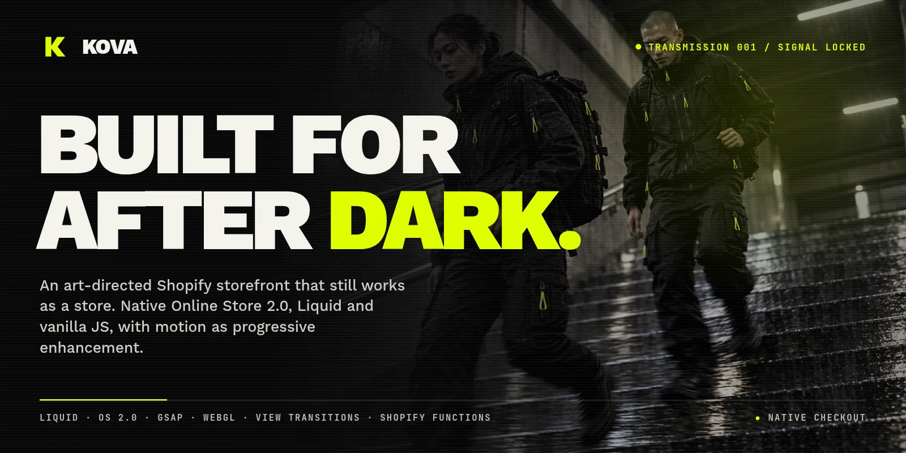
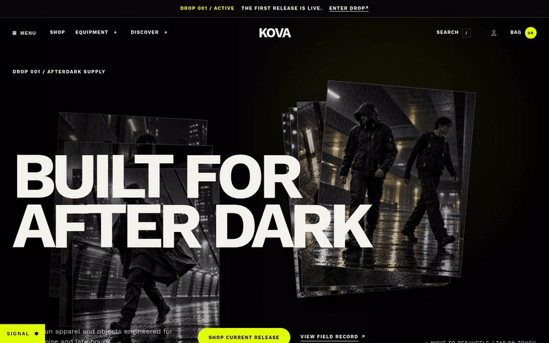
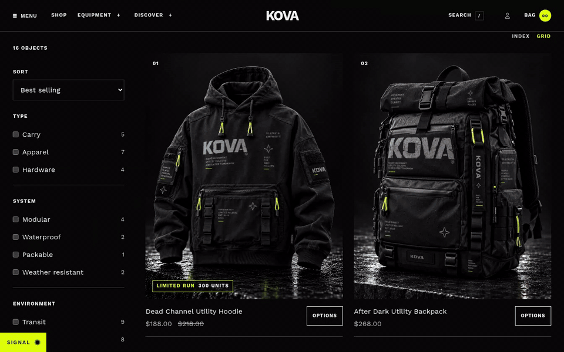
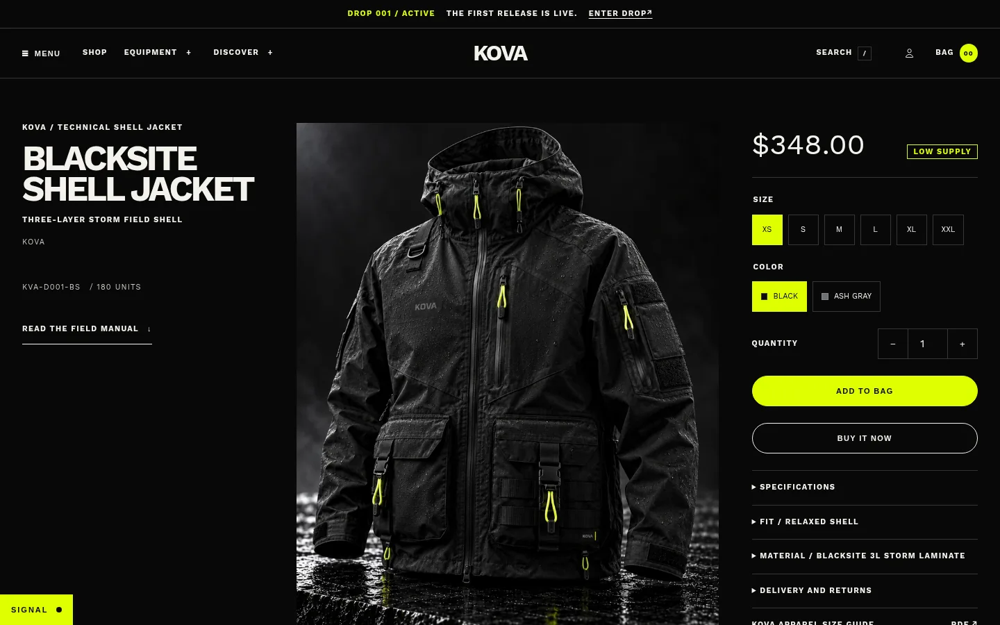
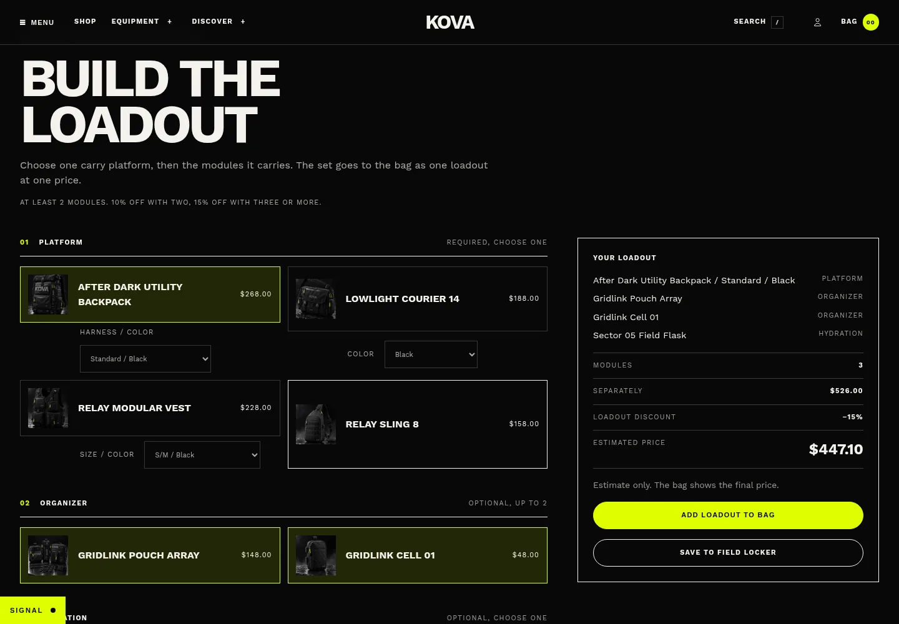
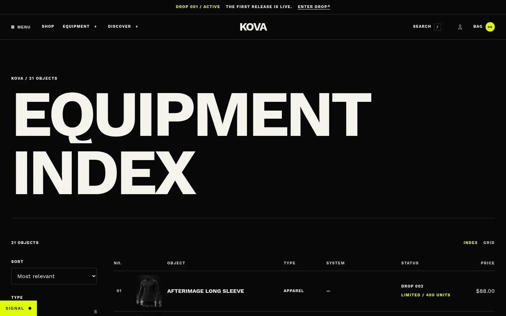
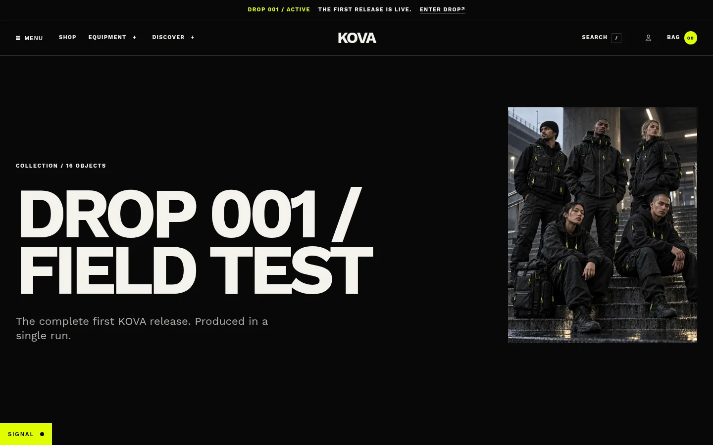
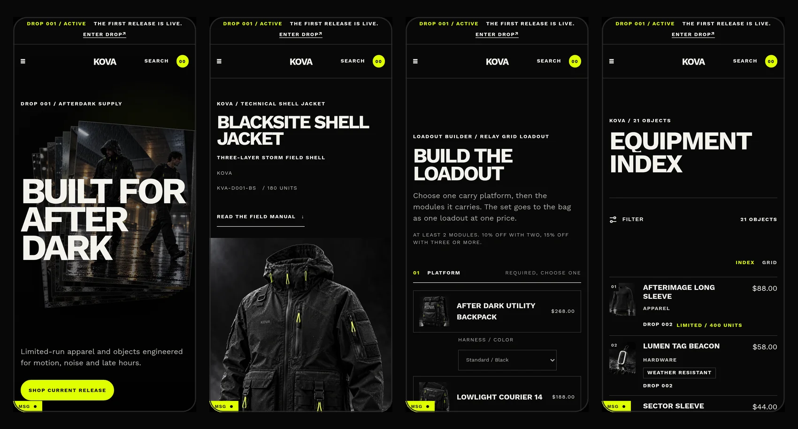
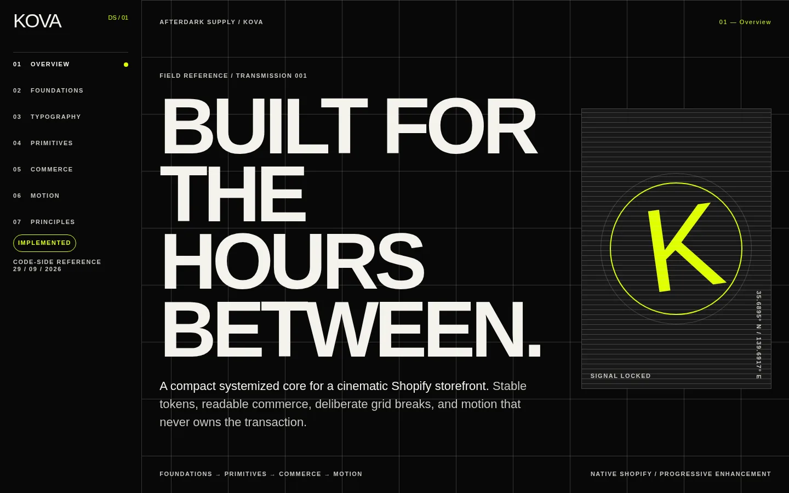

<p align="center">
  
</p>

<h1 align="center">KOVA</h1>

<p align="center">
  <strong>Night equipment, on a native Shopify theme.</strong><br>
  An art-directed storefront that still works as a store.
</p>

<p align="center">
  <a href="https://github.com/hrq-chiuchi/KOVA/actions/workflows/ci.yml"></a>
  
  
  
</p>

---

```
KOVA / TRANSMISSION 001 ........................ SIGNAL LOCKED
```

## What this is

KOVA is a portfolio project of mine. The brand is fictional: modular apparel and carry for people who move through the city at night (late shifts, last trains, rain, low light), released in numbered drops. The engineering is real, and it runs on a real Shopify development store.

I wanted to answer one question. **Can a storefront look like a film title sequence and still be a real Shopify theme?** That means merchant editing in the Theme Editor, JSON templates, native cart and checkout, keyboard access, and a reduced-motion mode that is designed, not bolted on.

So there's no headless stack, no React storefront and no SPA router. It's Liquid, vanilla JavaScript and CSS on Online Store 2.0, with motion layered on top as progressive enhancement. Switch GSAP off and you can still browse, pick a variant, build a loadout and check out.

## See it

<p align="center">
  
  <br><sub><b>Signal Acquisition.</b> The first-visit entry locks on the real hero, then tears away. It plays once per session.</sub>
</p>

<table>
  <tr>
    <td width="50%"><br><sub><b>Kinetic hero.</b> Image layers drop along the pointer path.</sub></td>
    <td width="50%"><br><sub><b>WebGL reveal and corrupted-signal transition.</b> One shared WebGL context, then a native cross-document View Transition.</sub></td>
  </tr>
  <tr>
    <td><br><sub><b>Product page.</b> Identity, price, variants and the checkout path stay plain and readable.</sub></td>
    <td><br><sub><b>Loadout builder.</b> Platform plus modules, priced live, added as one cart group.</sub></td>
  </tr>
  <tr>
    <td><br><sub><b>Equipment Index.</b> Faceted metafield filters, index or grid view.</sub></td>
    <td><br><sub><b>Drop 001.</b> Story-led collection template.</sub></td>
  </tr>
</table>

<p align="center">
  
  <br><sub><b>On a phone.</b> Same content order and hierarchy, so nothing depends on hover.</sub>
</p>

### Visit the store

The storefront runs on a Shopify development store, which Shopify keeps behind a password page.

1. Open **[kova-ne5bx2j5.myshopify.com](https://kova-ne5bx2j5.myshopify.com)**.
2. On the password page, enter **`KOVA-001`** and press Enter.
3. Browse as normal. It's a development store, so checkout can't take a real payment.

## The signal

These are the parts I'm proudest of. Each one links to the decision behind it.

| | |
| --- | --- |
| **Signal Acquisition** | A branded first-visit entry that tears a veil off the real hero, never a fake loading screen. It locks on the hero image and fonts, respects reduced motion, skips on any input, and plays once per session on the home page only. ([D-056](docs/case-study/decision-log.md#d-056--branded-entry-sequence--signal-acquisition)) |
| **Corrupted-signal page transitions** | Native cross-document View Transitions with stepped RGB-split and band-tear treatments. Every navigation is still a real page load, so Shopify's per-page scripts and analytics stay intact. ([D-017](docs/case-study/decision-log.md#d-017--use-native-cross-document-view-transitions-for-a-corrupted-signal-page-change)) |
| **Kinetic hero** | Pointer-driven image layers dropped along the cursor path. The hero can also draw its stack from a collection without losing the authored version. ([D-019](docs/case-study/decision-log.md#d-019--let-the-hero-follow-a-collection-without-losing-the-authored-hero), [D-029](docs/case-study/decision-log.md#d-029--drop-hero-layers-along-the-pointer-path-instead-of-carrying-the-stack)) |
| **One WebGL context** | Product reveals share a single bounded WebGL context and batch their intros, instead of spinning up one canvas per card. ([D-009](docs/case-study/decision-log.md#d-009--use-one-bounded-webgl-reveal-context), [D-021](docs/case-study/decision-log.md#d-021--batch-webgl-intros-on-the-single-shared-context)) |
| **Loadout builder** | Pick a carry platform, slot in modules, and add the whole set as one atomic cart group. A cart transform merges it into a single discounted line, and a validation function refuses invalid sets. ([D-024](docs/case-study/decision-log.md#d-024--model-loadouts-as-metaobjects-and-let-the-cart-transform-own-their-price), [D-027](docs/case-study/decision-log.md#d-027--build-loadouts-in-one-section-that-adds-a-single-atomic-group)) |
| **Field Locker** | A customer-account page for orders, saved and purchased loadouts, equipment and documents, built on customer account UI extensions. ([D-030](docs/case-study/decision-log.md#d-030--build-the-field-locker-on-customer-account-extensions-and-keep-orders-native)) |
| **Equipment Index** | Faceted filtering on choice-validated metafields with progressive section swaps, plus a command-palette search on native predictive search. ([D-035](docs/case-study/decision-log.md#d-035--index-facets-as-choice-validated-metafields), [D-036](docs/case-study/decision-log.md#d-036--filtering-by-progressive-section-swaps), [D-037](docs/case-study/decision-log.md#d-037--search-command-on-native-predictive-search)) |
| **Branded checkout** | Checkout and customer accounts take their colours from the same token values as the theme. ([D-033](docs/case-study/decision-log.md#d-033--brand-checkout-and-customer-accounts-from-the-theme-tokens)) |

## Rules I held myself to

- **Commerce never waits on decoration.** Navigation, variant selection, quantity, cart and checkout work without GSAP, ScrollTrigger or WebGL. ([D-005](docs/case-study/decision-log.md#d-005--separate-decorative-motion-from-commerce))
- **Native scrolling only.** No scroll hijacking. ScrollTrigger decorates the browser's scroll and never replaces it. ([D-004](docs/case-study/decision-log.md#d-004--keep-native-scrolling))
- **Reduced motion is a mode, not an off switch.** Parallax, loops and scrubbed timelines go away, while content order and hierarchy stay. ([D-006](docs/case-study/decision-log.md#d-006--treat-theme-editor-and-reduced-motion-as-architecture))
- **The Theme Editor is part of the architecture.** Motion initialises per section, cleans up on section unload and reload, and never registers a handler twice.
- **One token source.** DTCG token files are canonical, and `assets/tokens.css` is their checked-in code mapping. ([D-003](docs/case-study/decision-log.md#d-003--make-dtcg-token-files-canonical))
- **Art direction breaks the grid on purpose.** Asymmetry, overlap and oversized type stay local, documented exceptions, not global abstractions.
- **No invented evidence.** Anything untested is labelled as untested (see [Honest status](#honest-status)).

## How it's put together

```
.
├── assets/             CSS, vanilla JS modules, vendored GSAP, tokens.css
├── blocks/             kova-* theme blocks merchants can compose and reorder
├── config/             theme settings (including the Motion group)
├── layout/             theme shell, entry signal, page transition hooks
├── locales/            translations
├── sections/           authored sections: kinetic hero, loadout builder, index…
├── snippets/           implementation primitives: product card, status, filters…
├── templates/          OS 2.0 JSON templates (home, PDP, index, story, system…)
├── design-system/
│   └── tokens/         DTCG tokens: primitive → semantic → typography, motion, component
├── apps/kova-core/     KOVA Core, an extension-only Shopify app (no server, no tokens)
└── docs/
    ├── design-system/  inventory, taxonomy and verification status of every pattern
    └── case-study/     evidence record and the decision log
```

Everything new is classified before it's built: Foundation, Token, Primitive, Commerce component, Theme block, Section, Template, Motion behaviour, or Art-direction exception. Snippets are for implementation reuse. Theme blocks exist only where a merchant should actually compose something. ([D-002](docs/case-study/decision-log.md#d-002--use-an-explicit-system-taxonomy), [D-022](docs/case-study/decision-log.md#d-022--compose-art-direction-from-snippets-opinionated-theme-blocks-and-one-section))

### Design-system field reference

[`design-system/index.html`](design-system/index.html) is a standalone reference for foundations, typography, primitives, commerce anatomy and motion. It reads `assets/tokens.css` directly, so it can't drift from the theme. Open it straight from disk. ([D-063](docs/case-study/decision-log.md#d-063--the-design-system-reference-consumes-the-code-mapping))

<p align="center">
  
</p>

### KOVA Core

The app behind loadouts and the Field Locker. It's extension-only, so no storefront code ever holds an API token.

| Extension | Target | Job |
| --- | --- | --- |
| `loadout-merge` | `cart.transform.run` | Merges a valid loadout group into one line at the tier price |
| `loadout-guard` | `cart.validations.generate.run` | Refuses invalid groups and a directly added loadout parent |
| `field-locker` | `customer-account.page.render` | Orders, saved loadouts, equipment and documents |
| `field-locker-order` | `customer-account.order-status.block.render` | That order's loadouts and documents |

The storefront builder's verdict (`assets/loadout-verdict.js`) mirrors the functions' rules, and CI runs a parity test so the two can't drift. More in [`apps/kova-core/README.md`](apps/kova-core/README.md).

## Running it locally

You need the [Shopify CLI](https://shopify.dev/docs/api/shopify-cli) and a development store.

```bash
# Theme
shopify theme dev                 # local preview at http://127.0.0.1:9292
shopify theme check               # Liquid and theme linting

# KOVA Core
cd apps/kova-core
npm install
shopify app dev                   # previews all four extensions on the dev store
cd extensions/loadout-merge && npx vitest run   # transform fixtures + theme parity
```

The catalogue, metaobjects and loadout rules are seeded by scripts in `apps/kova-core/scripts/`. After editing loadout rules in the admin, run `sync-rules.mjs`.

CI runs Theme Check and the loadout rules parity test on every push.

## Honest status

What I've verified is written down, with how and where it was checked, in [`docs/design-system/README.md`](docs/design-system/README.md) and the [case study](docs/case-study/README.md).

## Credits

Built by [Henrique Chiuchi](https://github.com/hrq-chiuchi).

The theme foundation was bootstrapped from Shopify's Skeleton Theme and used as infrastructure only. The visual system and components are original ([D-001](docs/case-study/decision-log.md#d-001--use-skeleton-as-infrastructure-not-visual-inheritance)). Motion uses [GSAP](https://gsap.com). Third-party licenses are listed in [`NOTICE.md`](NOTICE.md).

```
END OF TRANSMISSION
```
